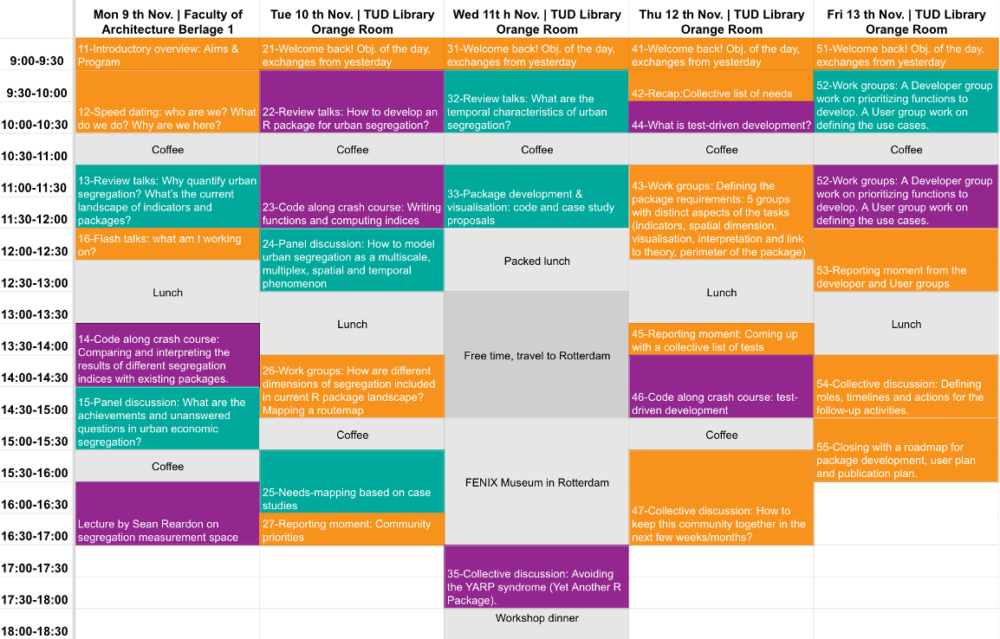

## Summary

[{fig-align="left" width="60"}](https://www.tudelft.nl/), [{fig-align="left" width="50"}](http://erc-segue.nl/) and [{fig-align="left" width="50"}](http://rbanism.org/) are gathering computational segregation experts between November 9th to November 13th 2026 to **identify and prioritise the methodological and technical developments needed to address big theoretical questions in the field of urban segregation (with R)**, through research discussions spanning the diversity of theories and approaches to urban segregation (in terms of location, scale and social attributes considered, as well as type of data used).

With this 5-day workshop, we have the objective to:

1.  create a robust **community** of urban scholars involved in comparative analysis, theory and methodology development in the field of urban segregation;
2.  prepare the development of a new **R package** dedicated to assist with the selection of appropriate measures of urban segregation (a “routemap”), their computation, visualization and analysis necessary to tackle state-of-the-art research questions in the field of urban segregation.

The full scientific case for this initiative can be read [here](https://erc-segue.nl/scientificCase).

## Program {#program}



This workshop has been meticulously prepared by an [organising team of 13 scholars](https://erc-segue.nl/Workshop#organising) from the Netherlands, UK, France, South Korea and Sweden to provide the social, intellectual and technical infrastructure to prepare for collaboration between [25 experts](https://erc-segue.nl/Workshop#participants) from all over the world during the workshop.

To make sure that our group is able to map and prioritize the most pressing needs of the community, identify the list of tests and case study to develop and evaluate the functions included in the package, the **first part of the workshop** is devoted to to reviewing the reasons for quantifying segregation, the pool of possible indices and methods for quantification and the existing software packages, and to an [invited lecture](https://erc-segue.nl/Workshop#lecture) from sean reardon, a central figure of segregation quantification. By discussing these elements and running through available tools on R through code-along moments, we address the levelling of information and skills for a pool of diverse participants. The **second part of the workshop** addresses the R package design and development planning, with group sessions dedicated to different aspects (indicators to code, spatial component to add, documentation and case study guide, etc.) and different roles (developer, user and interface).

**Post-workshop**, we will implement the roadmap to complete the package, write its documentation and user manual. Using [{fig-align="left" width="50"}](http://rbanism.org/)’s experience, [{fig-align="left" width="50"}](http://erc-segue.nl/)’s funding and the co-organisers’ time and coordination efforts, the community will be brought together virtually at regular intervals, as well as in person for a final conference showcasing the package and its use cases.


## Invited lecture {#lecture}

[sean reardon](https://ed.stanford.edu/faculty/seanreardon), Professor, Stanford Graduate School of Education and Stanford Institute for Economic Policy Research (SIEPR), USA.


## Workshop partipants {#participants}

1.  [Adrian Nowacki](https://github.com/Adrian-Nowacki), PhD Student, Doctoral School of Natural Sciences, Adam Mickiewicz University in Poznań, Poland.
2.  [Alok Kumar](https://github.com/Alok-Kumar-JNU), PhD Candidate, Jawaharlal Nehru University New Delhi, India.
3.  [Ana Petrović](https://github.com/ana-5r), Assistant Professor in urban studies at TU Delft, NL.
4.  [Benjamin Jarvis](https://github.com/bfjarvis), Associate Professor, Institute for Analytical Sociology, Linköping University, Sweden.
5.  [Benjamin Rosche](https://github.com/benrosche), Assistant Professor of Computational Social Science, New York University Abu Dhabi, Abu Dhabi.
6.  [Claudiu Forgaci](https://github.com/cforgaci), Assistant Professor in urban design and analytics at TU Delft, NL.
7.  [Clémentine Cottineau-Mugadza](https://github.com/ClementineCttn), Assistant Professor in urban studies at TU Delft, NL.
8.  [Daniele Cannatella](https://github.com/dcannatella), Assistant Professor in spatial data science at Delft, NL.
9.  [Giuliana La Mantia](https://github.com/giulianalm9), Post-doc researcher at University of Genoa, Italy.
10. [Guilherme Kenjy Chihaya Da Silva](https://github.com/chihayakenji), Associate Professor, Nord University, Faculty of Social Sciences, Norway.
11. [Ignacio Urria Yáñez](https://github.com/iurriayanez), PhD Candidate in urban studies at Delft, NL.
12. [Javier San Millan Tejedor](https://github.com/javiersanmillan), PhD Candidate in urban studies at Delft, NL.
13. [Jiannis Kaucic](https://github.com/jkaucic), Scientific Staff (Praedoc) at the Institute for Urban and Regional Research (ÖAW), Austria.
14. [Julie Vallée](https://github.com/JulieVallee), Senior researcher at CNRS, LISST, France.
15. [Julien Migozzi](https://github.com/jmigozzi), Assistant Professor in Development Studies at University of Cambridge, UK.
16. [Juta Kawalerowicz](https://github.com/jkawalerowicz), Lecturer at Stokholm University, Sweden.
17. [Karina Trelles](https://github.com/ktrelles), PhD candidate at University of Trieste, Italy.
18. [Nadeem Ullah](https://github.com/naddmm), Postdoctoral Researcher, School of Architecture, Tianjin University, China.
19. [Onur Tumturk](https://github.com/onurtumturk), Marie Curie Postdoc, Bilkent University, Turkey.
20. [Onyinyechi Gift Ossai](https://github.com/onyinyechi-ossai123), Senior Lecturer/University of Nigeria, Nsukka, Nigeria.
21. [Priyanka deSouza](https://github.com/pdez90), Assistant Professor, University of Colorado Denver, USA.
22. [Selcan Mutgan](https://github.com/selcanm), Assistant Professor at the Institute for Analytical Sociology in Linköping University, Sweden.
23. [Seong-Yun Hong](https://github.com/syunhong), Associate Professor at Kyung Hee University, South Korea.
24. [Timothee Giraud](https://github.com/rcarto), Research engineer at CNRS, UAR RIATE - Center for spatial analysis and geovizualisation, France.
25. [Yuliia Kazmina](https://github.com/yuliia-ka), PhD candidate at the Faculty of Social and Behavioural Sciences, University of Amsterdam, NL.

## Date & location

The workshop will take place over 5 full days: [**9, 10, 11, 12 and 13 November 2026**](https://github.com/SEGUE-Project/SEGUE-Project.github.io/blob/main/events.ics), at TU Delft, in the Netherlands.

- On 9th November 2026, we are hosted by the Faculty of Architecture and the Built Environment of TU Delft, Berlage Zaal, Building 8, Julianalaan 134, 2628 BL Delft, NL.
- On 10th, 11 th, 12th and 13th November 2026, we will be at the TU Delft Library, Orange room, Building 21, Prometheusplein 1, 2628 ZC Delft, NL.

```{r, echo=FALSE}
library(leaflet)

leaflet() %>% 
  setView(4.4, 51.95, 11) %>%
  addTiles() %>%
 addCircleMarkers(
      lng = 4.4816212, lat = 51.9021532,
    label = "FENIX Museum | 11th Nov.",
    radius = 10,
    color = "#00A99D",
    stroke = FALSE, fillOpacity = 0.5) %>%
  addCircleMarkers(
      lng = 4.4849081, lat = 51.9018146,
    label = "Workshop dinner | 11th Nov.",
    radius = 10,
    color = "#00A99D",
    stroke = FALSE, fillOpacity = 0.5) %>%
  addCircleMarkers(
      lng = 4.3705259, lat = 52.0056562,
    label = "TU Delft | Faculty of Architecture and the Built Environment | 9th Nov.",
    radius = 10,
    color = "#ff6600ff",
    stroke = FALSE, fillOpacity = 0.5) %>%
  addCircleMarkers(
      lng = 4.3730109, lat = 52.0026415,
    label = "TU Delft Library | 10-13th Nov.",
    radius = 10,
    color = "#ff6600ff",
    stroke = FALSE, fillOpacity = 0.5)


```

## Open Science & funding {#fund}

This is an **open source** project.

Preparation materials and upcoming contributions are hosted on [github.com/SEGUE-Project/2026Workshop](https://github.com/SEGUE-Project/2026Workshop) using two licenses:

- Apache License 2.0. for Code (R source, tests, and other software)
- Creative Commons Attribution 4.0 International (CC BY 4.0) for workshop materials and outputs (data, presentations, notebooks, prose, figures, and other non-code content)

The workshop is free for selected participants. It is **funded** by the European Research Council (ERC) 101039455 Starting Grant Project [{fig-align="left" width="50"}](http://erc-segue.nl/), and hosted gratuitously by the [{fig-align="left" width="80"}](https://www.tudelft.nl/en/architecture-and-the-built-environment) Faculty of Architecture and the Built environment and the [{fig-align="left" width="80"}](https://www.tudelft.nl/en/library/) Library.

## Organizing team {#organising}

- [Ana Petrovic](https://research.tudelft.nl/en/persons/a-petrovi%C4%87/), Assistant Professor in urban studies at [{fig-align="left" width="60"}](https://www.tudelft.nl/) [{fig-align="left" width="30"}](http://rbanism.org/)

- [Claudiu Forgaci](https://cforgaci.github.io/), Assistant Professor in urban design at [{fig-align="left" width="60"}](https://www.tudelft.nl/) [{fig-align="left" width="30"}](http://rbanism.org/)

- [Clémentine Cottineau-Mugadza](https://clementinecttn.github.io/), Assistant Professor in urban studies at [{fig-align="left" width="60"}](https://www.tudelft.nl/) [{fig-align="left" width="30"}](http://rbanism.org/)[{fig-align="left" width="30"}](http://erc-segue.nl/)

- [Daniele Cannatella](https://www.tudelft.nl/staff/d.cannatella/), Assistant Professor in spatial data science at [{fig-align="left" width="60"}](https://www.tudelft.nl/) [{fig-align="left" width="30"}](http://rbanism.org/)

- [Ignacio Urria Yáñez](https://www.tudelft.nl/staff/i.a.urriayanez/), PhD Candidate in urban studies at [{fig-align="left" width="60"}](https://www.tudelft.nl/) [{fig-align="left" width="30"}](http://rbanism.org/)

- [Javier San Millan Tejedor](https://javiersanmillan.github.io/), PhD Candidate in urban studies at [{fig-align="left" width="60"}](https://www.tudelft.nl/) [{fig-align="left" width="30"}](http://rbanism.org/)[{fig-align="left" width="30"}](http://erc-segue.nl/)

- [Julie Vallée](https://lisst.univ-tlse2.fr/home/julie-vallee), Senior researcher at CNRS, LISST, France

- [Julien Migozzi](https://jmigozzi.github.io/), Assistant Professor in Development Studies at University of Cambridge, UK

- [Levi John Wolf](https://www.ljwolf.org/), Associate Professor of Spatial Analysis at the University of Bristol , UK

- [Selcan Mutgan](https://www.selcanmutgan.com/), Assistant Professor at the Institute for Analytical Sociology in Linköping University, Sweden

- [Seong-Yun Hong](https://khu.elsevierpure.com/en/persons/seong-yun-hong/), Associate Professor at Kyung Hee University, South Korea

- [Yuliia Kazmina](https://www.uva.nl/en/profile/k/a/y.kazmina/y.kazmina.html), PhD candidate at the Faculty of Social and Behavioural Sciences, University of Amsterdam (NL)
